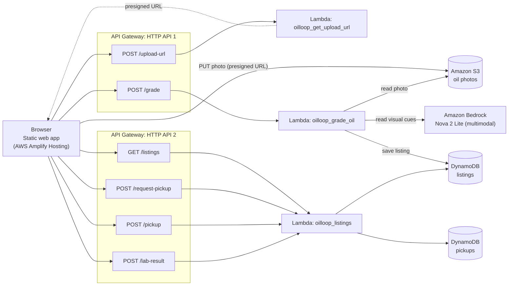
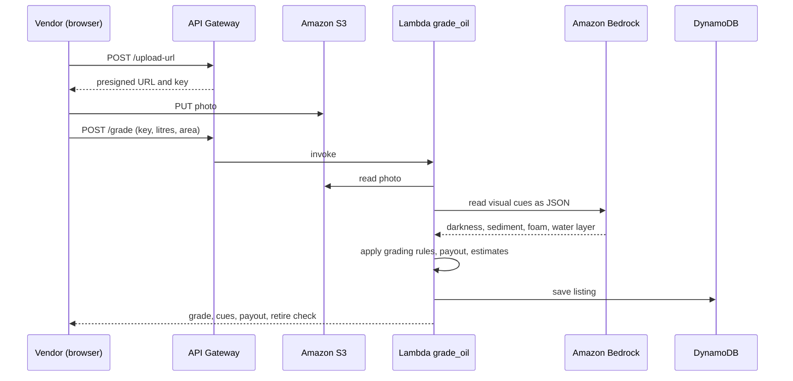

# OilLoop

Routes street vendors’ used cooking oil to biodiesel processors. Vendors photograph their oil, get a graded payout estimate, and request a pickup. Collectors get a time-ordered route with a truck-load check. Processors see incoming batches, estimated biodiesel yield, diesel displaced and CO2e, and record lab results to measure how well the photo screening matches the lab.

**Live demo:** https://staging.d23bpimsljvz1v.amplifyapp.com/

## Why this problem
India blends roughly 0.5-0.6% biodiesel against a 5% target for 2030 (USDA GAIN), so collecting enough feedstock is the bottleneck. Used cooking oil is a ready feedstock, and FSSAI's RUCO programme already targets its collection. At the same time, oil reused past the 25% total polar compounds limit is a food-safety concern. OilLoop gives vendors a reason to retire oil on time (they get paid) and gives processors a steadier, graded supply.

## How it works
1. **Vendor**: take or choose a photo of oil in a clear glass. The photo uploads straight to S3 (presigned URL). Enter litres, times reused and area. The app returns a grade, the visible cues, a retire check, a payout range and impact estimates.
2. **Pickup request**: choose a date and time slot, quantity and address (stored, never shown publicly).
3. **Collector**: sees tomorrow's stops ordered by time slot. **Start route** unlocks when the truck is at least 60% full and a destination (biodiesel facility) is set.
4. **Processor**: sees litres by grade, estimated biodiesel, diesel displaced and CO2e, with editable assumptions, plus a **Lab check** where lab grades are recorded against the photo grade.

## Architecture

##Vendor Flow


### AWS services
Amazon Bedrock (Amazon Nova 2 Lite via a global inference profile), AWS Lambda (Python, boto3), Amazon API Gateway (HTTP APIs), Amazon DynamoDB, Amazon S3, AWS Amplify Hosting, IAM, CloudWatch.

### API routes
| API | Route | Purpose |
|---|---|---|
| 1 | `POST /upload-url` | Presigned S3 upload URL |
| 1 | `POST /grade` | Read the photo and return grade, cues, payout, estimates |
| 2 | `GET /listings` | Recent listings (no addresses) |
| 2 | `POST /request-pickup` | Vendor pickup request (date, slot, address) |
| 2 | `POST /pickup` | Collector starts a route (destination, trips) |
| 2 | `POST /lab-result` | Record a lab grade for a batch |

## Grading (pilot, rule-based)
Bedrock reads visible cues from the photo as JSON (darkness, sediment, foam, water layer, whether it looks like oil). Transparent rules then set the grade:

| Grade | Label | Rule (darkness score + sediment score) |
|---|---|---|
| A | Prime feedstock | total 0-2 (light/medium colour, little or no sediment) |
| B | Standard feedstock | total 3-4 |
| C | Low-grade feedstock | total 4+ (dark or black with heavy sediment) |
| Reject | Not accepted | visible water layer or non-oil mixture |

Darkness: light 0, medium 2, dark 3, black 4. Sediment: none 0, light 1, heavy 2.
A **retire check** is raised when foam, dark colour or heavy sediment is seen, or when the vendor's reported reuse count reaches an adjustable limit (default 5, an assumption).

This is a **screening grade, not a lab test**. The processor confirms by lab test. Real feedstock suitability depends on free fatty acids, moisture and impurities, which a photo cannot measure.

## Assumptions and sources
All numbers used for payout, yield and impact are **estimates**, listed with sources and confidence in [`docs/uco_reference_data.json`](docs/uco_reference_data.json): FSSAI RUCO (25% TPC limit), USDA GAIN India Biofuels Annual (blend targets), published lifecycle studies (CO2e), and a trade/research range for collection prices. Yields per grade (0.86 / 0.78 / 0.65) and the CO2e factor are adjustable in the Processor view.

## Honest limitations
- No trained model: grading uses a multimodal LLM to read cues plus rules. I found no public labeled dataset of used-oil photos. The **Lab check** records lab grades so a labeled dataset (and a real classifier) can be built.
- Colour is an unreliable proxy for oil quality on its own; the AI's darkness reading is an estimate, not a measurement.
- No authentication: roles are tabs, and the APIs are open. Addresses are stored but never returned.
- Vendor notifications (WhatsApp/app) are not built; the app shows a preview of the planned message.
- Demo data is always tagged DEMO.

## Run and deploy
1. **S3**: private bucket with a CORS rule allowing `GET, PUT, POST, HEAD` and headers `*`.
2. **DynamoDB**: tables `listings` and `pickups`, partition key `id` (string), on-demand.
3. **Lambda** (Python 3.12, role with S3, DynamoDB and Bedrock access): deploy `backend/lambda_get_upload_url.py`, `backend/lambda_grade_oil.py` and `backend/lambda_listings.py`.
   - `get_upload_url`: `BUCKET`.
   - `grade_oil`: `BUCKET`, `BEDROCK_MODEL_ID=global.amazon.nova-2-lite-v1:0`, `TABLE=listings`, optional `FRY_RETIRE_AT=5`; timeout 60 s, memory 512 MB.
   - `listings`: `TABLE`, `PICKUPS` (defaults `listings`, `pickups`).
4. **API Gateway**: create the routes in the table above and enable CORS (`*`, methods `GET, POST, OPTIONS`, header `content-type`).
5. **Frontend**: set `API` and `API2` at the top of `frontend/index.html`, zip it with `index.html` at the root, and upload with Amplify "Deploy without Git".
6. Optional: `backend/lambda_assist.py` adds a multilingual assistant route (`POST /assist`); it is not wired into the UI in this version.

## Repository layout
```
frontend/index.html     single-file web app (vanilla JS, SVG, CSS)
backend/                Lambda functions
docs/uco_reference_data.json   assumptions with sources and confidence
```

## Roadmap
Vendor notifications (WhatsApp / app), authentication and per-user data, Bengali/Hindi assistant in the UI, collecting lab-confirmed photos to train and evaluate a real classifier, and cost/abuse limits on the public APIs.
